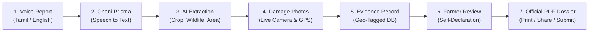

# RaidProof AI (வேலி காப்பான்)
## AI-Powered Wildlife Crop Damage Evidence Assistant for Indian Farmers

[](https://fastapi.tiangolo.com)
[](https://react.dev)
[](https://gnani.ai)
[](backend/tests)
[](LICENSE)

**RaidProof AI** is a production-grade, voice-first evidence preparation platform built for smallholder Indian farmers affected by wildlife crop incursions (elephants, wild boars, gaurs). It combines **Gnani Prisma v3.0** (Tamil & English Speech-to-Text), **Gnani Timbre v3.0** (Text-to-Speech), an **Agricultural AI Extraction & Contradiction Engine**, geo-tagged camera evidence, and the official **2-Page Form WCD-01 (Citizen Report) PDF Complaint Generator** aligned with the Tamil Nadu Forest Department ex-gratia submission standards.

---

## ⚠️ Regulatory & Safety Notice
> **The system must never claim that AI has officially verified an incident or approved a compensation claim.**
> 
> RaidProof AI strictly functions as a **farmer self-declaration evidence preparation assistant**. All claims, acreage, damage quantities, and relief amounts are self-reported by the cultivator to expedite physical joint field inspections by the **Forest Range Officer** and **Village Administrative Officer (VAO)** under State Government rules.

---

## 🔄 Core Workflow



1. **Farmer Reports via Voice**: The farmer records their crop damage narrative naturally in **Tamil** (*தமிழ்*) or **English**.
2. **Gnani Prisma Speech Recognition**: Converts spoken audio into high-accuracy vernacular transcript.
3. **AI Extraction & Reasoning**: Extracts structured entities (wildlife species, damaged crop, tree count/acreage, incident time) and resolves biological/density contradictions neutrally.
4. **Damage Photography & GPS**: Farmer captures field photographs with hardware GPS coordinates stamped automatically.
5. **Structured Evidence Record**: The system stores tamper-evident evidence records with precise geographic provenance.
6. **Farmer Review & Confirmation**: The farmer reviews all extracted details and signs a self-declaration statement.
7. **Official PDF Dossier Generation**: Generates an authentic, 2-page bilingual Form WCD-01 PDF dossier with embedded photos, satellite map pin, farmer declaration, and office use inspection block.

---

## 🌟 Key Features

### 1. Voice-First Bilingual Interface (Tamil & English)
- **Gnani Prisma v3.0 STT**: Custom-primed with agricultural vocabulary (*யானை, காட்டுப்பன்றி, காட்டெருமை, வாழை, தென்னை, நெல், கரும்பு, மக்காச்சோளம், பட்டா, சிட்டா, அடங்கல், ஏக்கர்*).
- **Gnani Timbre v3.0 TTS**: Delivers natural spoken confirmation back to the farmer in regional Tamil prosody (`ta-IN`, `voice=Kavitha`).
- **Resilient Fallback**: Seamless fallback to offline speech simulation if network is degraded.

### 2. Official Form WCD-01 (Citizen Report) 2-Page Departmental Format
- **Strict Government Layout**:
  - **Page 1**: State emblems, complaint metadata, **Section 1** (Farmer Details), **Section 2** (Land & Crop Particulars with stage checkboxes and estimated loss), **Section 3** (Incident Details with animal checkboxes and brief description), and Attached Evidences strip.
  - **Page 2**: **Section 4** (Dual Photographic Evidence: damaged crop & camera capture with burned timestamps), **Section 5** (Location GPS Details & satellite map pin), **Section 6** (Farmer Declaration & signature), **Section 7** (For Office Use Only field inspection table & authorized officer seal box), and statutory citizen report notice.
- **Hardware GPS Stamps**: Burns latitude, longitude, accuracy radius (±m), and capture timestamp onto every photo.
- **Authentic Assets Embedded**: Tamil Nadu state emblem, Forest Department tree/elephant emblem, satellite map snippet, and cultivator signature.

### 3. Tamil Nadu Government Relief Norms & Calculator (G.O. Ms. No. 42)
- Official ex-gratia compensation schedule based on **G.O. Ms. No. 42 (Environment & Forests Department)**:
  - **Paddy (நெல்)**: ₹10,000 / acre (₹25,000 / hectare)
  - **Maize / Cholam (சோளம்)**: ₹8,000 / acre (₹20,000 / hectare)
  - **Banana (வாழை)**: ₹300 / bearing tree (₹150 / young sucker)
  - **Coconut (தென்னை)**: ₹1,500 – ₹3,000 / bearing palm
  - **Sugarcane (கரும்பு)**: ₹25,000 / acre
  - **Cattle / Buffalo Loss (கால்நடை)**: ₹30,000 / cattle
- **Interactive Calculator**: Farmers can estimate guideline compensation and transfer parameters directly into a new report with 1 click.

### 4. 24x7 Forest Department Emergency Directory & Control Rooms
- Instant click-to-call directory:
  - **Statewide Toll-Free Helpline**: **`1926`** (24 Hours Active)
  - **Anamalai Tiger Reserve (ATR) Control Room (Pollachi)**: `04259 235385` / `1800 425 4545`
  - **Valparai Forest Range Office**: `04253 222234`
  - **Manambolly Forest Range Office**: `04253 222235`
  - **Coimbatore Elephant Flying Squad**: `0422 2434777`
  - **Nilgiris Wildlife Depredation Response Team**: `0423 2444071`
  - **Sathyamangalam Tiger Reserve (STR)**: `04295 220312`

### 5. Live Wildlife Movement Alert Banner
- Real-time forest border advisory (*"வால்பாறை - ஆனைமலை புலிகள் காப்பக எல்லை பகுதியில் 4 காட்டு யானைகள் நடமாட்டம் கண்டறியப்பட்டுள்ளது..."*).

### 6. Interactive Leaflet OpenStreetMap Location Picker
- OpenStreetMap Leaflet integration with interactive marker placement, reverse geolocation, and accuracy bounding circles.

### 7. Instant Dossier Print, Download & WhatsApp Share
- Built-in PDF iframe preview with direct browser **Print**, **Download**, and prefilled **WhatsApp Share** (`wa.me`) message containing incident ID and verification link.

---

## 🏛️ Application Screen Flow (9-Screen Architecture)

The frontend features a clean, human-designed green & white interface matching rural agricultural application standards:

| Screen | View | Description |
| :---: | :--- | :--- |
| **1** | **Landing Page** | Value proposition, quick feature cards, language toggle, and direct call-to-action. |
| **2** | **Farmer Dashboard** | Live wildlife alert banner, report statistics, quick links to Relief Calculator & Emergency Helplines. |
| **3** | **Voice Reporting** | Push-to-talk microphone, real-time waveform visualization, sample agricultural prompts, and 1-click test scenarios. |
| **4** | **Transcription & Extraction** | Spoken transcript view, structured AI entity card, audio playback, and neutral ambiguity prompts. |
| **5** | **Add Evidence** | Live camera capture with GPS, gallery upload, realistic damage simulations, and OpenStreetMap picker. |
| **6** | **Review & Confirm** | Full incident summary card, photo grid, legal affirmation checkbox, and dossier generation trigger. |
| **7** | **Evidence Dossier Preview** | Single-page PDF viewer, direct Print button, PDF Download, and WhatsApp Share. |
| **8** | **My Reports** | Incident history table with filter tabs (*All*, *Under Review*, *Completed*) and direct dossier view. |
| **9** | **Profile & Settings** | Land parcel records (Patta, Survey No, Acres), Timbre audio toggle, language switcher, and offline mode. |

---

## 🏗️ System Architecture & Technology Stack

```
RaidProof-AI/
├── backend/                    # FastAPI Async Service
│   ├── app/
│   │   ├── api/v1/endpoints/   # incidents.py, voice.py, dossier.py, health.py
│   │   ├── core/               # config.py, database.py, security.py
│   │   ├── models/             # farmer.py, incident.py, evidence_photo.py
│   │   ├── schemas/            # incident.py, voice.py, dossier.py
│   │   └── services/
│   │       ├── ai/             # extractor.py, contradiction_engine.py
│   │       ├── dossier/        # pdf_generator.py (ReportLab + Noto Sans Tamil)
│   │       └── voice/          # gnani_client.py, mock_service.py
│   ├── static/assets/          # Real species & field imagery (elephant, boar, gaur, field)
│   ├── static/fonts/           # Noto Sans Tamil (Regular & Bold)
│   └── tests/                  # Pytest test suites (17 tests)
│
├── frontend/                   # React 18 + TypeScript + Vite + Tailwind CSS
│   ├── src/
│   │   ├── components/         # AudioWaveform, SpokenAudioPlayer, LocationMapPicker
│   │   ├── hooks/              # useAudioRecorder, useCameraGPS
│   │   ├── services/           # offlineDb (Dexie.js IndexedDB)
│   │   └── App.tsx             # Main 9-screen wizard & navigation
│   └── public/                 # Static assets & PWA manifest
└── docs/                       # Project documentation & verification reports
```

### Technology Matrix
- **Frontend**: React 18, TypeScript, Vite, Tailwind CSS v4, Lucide Icons, Leaflet / React-Leaflet, Dexie.js (IndexedDB).
- **Backend**: Python 3.13, FastAPI, Uvicorn, SQLAlchemy 2.0 (AsyncIO), SQLite, ReportLab, Pillow, PyPDF.
- **Voice AI**: Gnani Prisma v3.0 (ASR) & Gnani Timbre v3.0 (TTS).
- **Reasoning**: Gemini API / Rule-based Agricultural Contradiction Engine.

---

## 🚀 Getting Started

### Prerequisites
- Python 3.11+ (Python 3.13 recommended)
- Node.js 18+ and npm
- Git

### 1. Clone Repository & Setup Branch
```bash
git clone https://github.com/karthickvel123/RaidProof-AI.git
cd "RaidProof-AI"
git checkout fix/critical-audit-findings
```

### 2. Backend Setup
```bash
cd backend
python -m venv venv
# On Windows:
.\venv\Scripts\activate
# On Linux/macOS:
source venv/bin/activate

pip install -r requirements.txt
```

Run the backend server:
```bash
python -m uvicorn app.main:app --host 0.0.0.0 --port 8000 --reload
```
The backend API will be available at: `http://localhost:8000` (Swagger docs: `http://localhost:8000/docs`).

### 3. Frontend Setup
```bash
cd ../frontend
npm install
npm run dev -- --host 0.0.0.0 --port 5173
```
The application will be accessible at:
- Local browser: `http://localhost:5173`
- Mobile phones on the same Wi-Fi network: `http://<YOUR_LOCAL_IP>:5173`

---

## 🧪 Automated Testing

Run the full backend test suite:
```bash
cd backend
.\venv\Scripts\pytest -v
```

### Test Suite Results (17/17 Passed)
```
backend/tests/test_api_endpoints.py::test_health_endpoint PASSED
backend/tests/test_api_endpoints.py::test_voice_listen_api PASSED
backend/tests/test_api_endpoints.py::test_sample_dossier_pdf_api PASSED
backend/tests/test_api_endpoints.py::test_voice_diagnostics_endpoint PASSED
backend/tests/test_api_endpoints.py::test_voice_diagnostics_stt_ok_tts_fail_is_degraded PASSED
backend/tests/test_api_endpoints.py::test_voice_diagnostics_tts_ok_stt_fail_is_degraded PASSED
backend/tests/test_evidence_integrity.py::test_evidence_upload_validations PASSED
backend/tests/test_farmer_workflow_e2e.py::test_full_farmer_workflow_and_deduplication PASSED
backend/tests/test_incident_concurrency.py::test_concurrent_incident_creation_and_unique_codes PASSED
backend/tests/test_incident_concurrency.py::test_validation_rejects_non_positive_damage_and_acres PASSED
backend/tests/test_pdf.py::test_generate_pdf_dossier PASSED
backend/tests/test_reasoning_suite.py::test_mock_voice_service PASSED
backend/tests/test_reasoning_suite.py::test_incident_extractor_tamil PASSED
backend/tests/test_reasoning_suite.py::test_neutral_clarification_unspecified_wildlife PASSED
backend/tests/test_reasoning_suite.py::test_no_fixed_crop_quantity_threshold_triggers_review PASSED
backend/tests/test_reasoning_suite.py::test_explicit_multi_plot_narrative_clarification PASSED
backend/tests/test_reasoning_suite.py::test_real_vs_mock_separation_never_silent_fallback PASSED

============================= 17 passed in 7.96s =============================
```

Frontend compilation test:
```bash
cd frontend
npm run build
```
Builds cleanly with **0 errors and 0 warnings**.

---

## 📜 Regulatory Disclaimer
RaidProof AI produces self-declared evidence records. Neither this software nor its AI models have the authority to officially approve or disburse Government ex-gratia compensation. All claims are subject to statutory field verification by the Forest Department, Revenue Department, and local Village Administrative Officers.

---

## 📄 License
This project is open-source under the MIT License.
