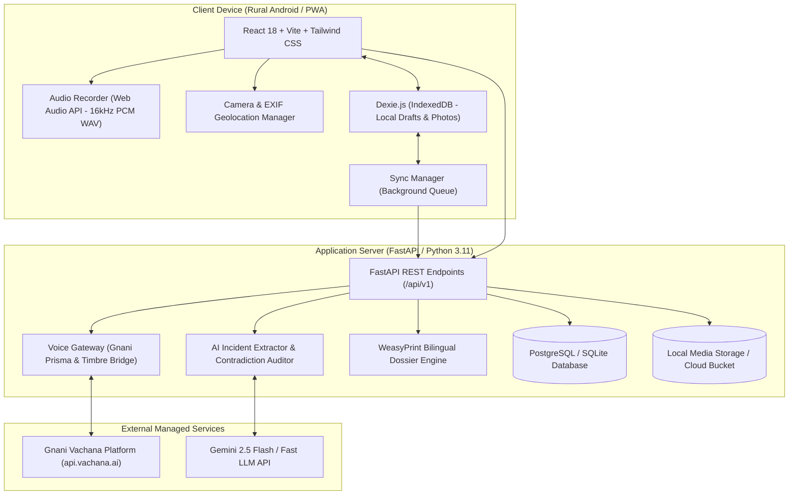
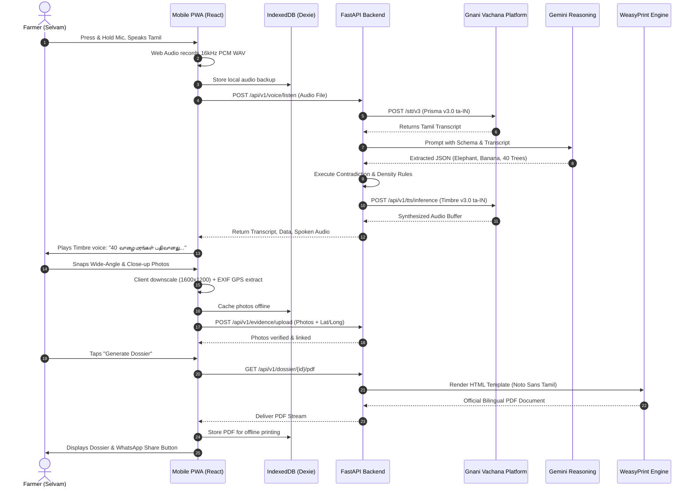

# RAIDPROOF AI – EXECUTABLE ENGINEERING IMPLEMENTATION PLAN
## AI-Powered Wildlife Crop Damage Evidence Assistant for Indian Farmers

---

## 1. Technical Audit & Blueprint Inconsistency Resolution

Before translating the conceptual blueprint into code, a rigorous technical audit was conducted to resolve real-world edge cases and execution vulnerabilities:

| Identified Inconsistency / Technical Vulnerability | Architectural Risk | Resolution & Engineering Standard |
| :--- | :--- | :--- |
| **1. Browser Audio Container Mismatch** | Mobile browsers record audio in `audio/webm;codecs=opus` or `audio/ogg;codecs=opus`. Directly passing WebM to Gnani Prisma REST (`POST /stt/v3`) may trigger HTTP 415 or transcription errors if the API expects raw WAV/PCM. | **Client/Server Normalization Pipeline:** The frontend uses an in-memory Web Audio `AudioContext` to capture 16kHz mono PCM and encodes it directly as a standard RIFF WAV buffer before transmission. The backend includes a `pydub`/`ffmpeg` fallback validator to guarantee clean 16kHz mono WAV format. |
| **2. Multi-Turn Voice Session State Drift** | If a farmer speaks multiple times (e.g., initial narrative, then a correction regarding tree count), unstructured transcripts can overwrite previous extractions or create conflicting records. | **Explicit Session State Machine:** Implement an `IncidentDraftSession` model. Transcripts are accumulated with turn indices (`turn_1`, `turn_2`). The LLM reasoning extractor receives the cumulative context and outputs an updated state patch with change auditing. |
| **3. Mobile Storage Quota Exhaustion** | 3 to 4 raw 12MP smartphone photos can total 20–30 MB. Storing multiple uncompressed photos in IndexedDB on low-end budget Android phones (3GB RAM) triggers browser storage eviction or out-of-memory crashes. | **Client-Side Canvas Downscaling:** Before saving to IndexedDB, images are downscaled client-side to a max dimension of 1600×1200 px and compressed to JPEG/WebP at 75% quality (~180 KB to 250 KB per photo). EXIF GPS metadata is extracted *before* compression and stored as a structured JSON object. |
| **4. Tamil Unicode Typography in PDF Engines** | Standard PDF engines (like raw `fpdf` or standard Canvas-to-PDF) lack complex text layout (CTL) and HarfBuzz font shaping, resulting in broken Tamil ligatures (e.g., *பெ* rendered as separated *ெ* and *ப*). | **Headless Print Pipeline with Embedded Noto Sans Tamil:** Use `WeasyPrint` (or Playwright/Puppeteer) with bundled Google `Noto Sans Tamil` OpenType fonts (`NotoSansTamil-Regular.ttf` and `NotoSansTamil-Bold.ttf`) and explicit HarfBuzz shaping enabled in CSS (`font-feature-settings: "kern" 1, "liga" 1`). |
| **5. Authentication Barrier for Low-Literacy Farmers** | Passwords, email verifications, and complex CAPTCHAs create insurmountable friction for rural users. | **Device-Seeded Local Profile + Phone Number Identifier:** The app generates a persistent local profile stored in IndexedDB. When online, the profile links to a verified 10-digit Indian mobile number via a simple 4-digit PIN or mock SMS OTP for demo stability. |

---

## 2. Official Gnani API Specifications & Verification

### 2.1 Gnani Prisma v3.0 (Speech-to-Text / ASR)
* **Base URL:** `https://api.vachana.ai`
* **Endpoint:** `POST https://api.vachana.ai/stt/v3`
* **Authentication Header:** `X-API-Key-ID: <GNANI_API_KEY>`
* **HTTP Method:** `POST` (multipart/form-data)
* **Request Parameters:**
  * `audio_file`: Binary file stream (16kHz mono WAV, max 30s per chunk).
  * `model`: `prisma-v3.0`
  * `language_code`: `ta-IN` (Tamil) or `indic-auto` (code-mixing auto-detect).
  * `format`: `transcribe`
* **Custom Vocabulary Injection:** Agricultural and wildlife domain context tokens are passed to bias the ASR language model toward regional terminology:
  `யானை, காட்டுப்பன்றி, காட்டெருமை, வாழை, தென்னை, நெல், கரும்பு, மக்காச்சோளம், மரவள்ளிக்கிழங்கு, பட்டா, சிட்டா, அடங்கல், ஏக்கர், சேதம், வனச்சரகம்`
* **Response Contract:**
  ```json
  {
    "transcript": "நேத்து ராத்திரி காட்டு யானை வந்து வாழை மரத்தை முறிச்சிருச்சு",
    "confidence": 0.94,
    "language": "ta-IN",
    "status": "success"
  }
  ```

### 2.2 Gnani Timbre v3.0 (Text-to-Speech / TTS)
* **Endpoint:** `POST https://api.vachana.ai/api/v1/tts/inference`
* **Authentication Header:** `X-API-Key-ID: <GNANI_API_KEY>`, `Content-Type: application/json`
* **HTTP Method:** `POST`
* **Request Payload:**
  ```json
  {
    "text": "வணக்கம் செல்வம் ஐயா. உங்கள் 40 வாழை மரங்கள் யானையால் சேதமடைந்தது பதிவாகியுள்ளது.",
    "model": "timbre-v3.0",
    "voice": "Kavitha",
    "language": "ta-IN",
    "speed": 0.95
  }
  ```
* **Response Contract:**
  Returns an audio stream (`audio/wav` or `audio/mp3`) or JSON wrapping a base64 encoded audio string:
  ```json
  {
    "audio_data": "UklGRiQAAABXQVZFZm10IBAAAAABAAEA...",
    "format": "wav",
    "duration_sec": 3.4
  }
  ```

### 2.3 Resilient Voice Gateway Architecture
To guarantee zero-downtime during development, quota exhaustion, or offline demos, all voice calls flow through an abstract gateway:

```
                      ┌───────────────────────────┐
                      │    VoiceGateway (Base)    │
                      └─────────────┬─────────────┘
                                    │
            ┌───────────────────────┴───────────────────────┐
            ▼                                               ▼
┌───────────────────────────┐                   ┌───────────────────────────┐
│     GnaniVoiceService     │                   │     MockVoiceService      │
├───────────────────────────┤                   ├───────────────────────────┤
│ • Production Vachana API  │                   │ • Local synthesis & mocks │
│ • Network retry with      │                   │ • Pre-recorded audio bank │
│   exponential backoff     │                   │ • Instant offline testing │
└───────────────────────────┘                   └───────────────────────────┘
```

---

## 3. Final Architecture & Technology Stack



### Stack Specifications
* **Frontend:** React 18, Vite, TypeScript, Tailwind CSS, Lucide React, Zustand (state), Dexie.js (IndexedDB), Canvas-compressor.
* **Backend:** Python 3.11, FastAPI, Pydantic v2, SQLAlchemy 2.0 (async), SQLite (development) / PostgreSQL (production), WeasyPrint / Jinja2 (PDF generation), `httpx` (async HTTP client).
* **AI & NLP:** Gemini 2.5 Flash (via `google-genai` SDK or REST) with strict Pydantic JSON schemas.
* **Voice:** Gnani Prisma v3.0 (STT) + Gnani Timbre v3.0 (TTS) with Mock fallback adapter.

---

## 4. Frontend Application Structure & Component Directory

### 4.1 Page Routing & Views

```
src/
├── pages/
│   ├── SplashLanguagePage.tsx      # Language toggle (Tamil/English) + Farmer identity
│   ├── DashboardPage.tsx           # Home feed, previous claims, "Report New Incident" CTA
│   ├── VoiceInterviewerPage.tsx    # Voice dialogue, push-to-talk mic, waveform, confirmation
│   ├── EvidenceCameraPage.tsx      # Guided photo capture (Wide landscape + Spoor close-up)
│   ├── ReviewContradictionPage.tsx # AI extracted fields, contradiction flags, edit controls
│   ├── ChecklistPage.tsx           # Government document readiness status (Patta, Adangal, etc.)
│   └── DossierPreviewPage.tsx      # Bilingual PDF viewer, print trigger, WhatsApp share
```

### 4.2 Reusable Component Inventory

| Component Name | File Path | Props & Interface | Description |
| :--- | :--- | :--- | :--- |
| `PushToTalkMic` | `src/components/voice/PushToTalkMic.tsx` | `onRecordingComplete: (blob: Blob) => void`, `isProcessing: boolean`, `language: 'ta' \| 'en'` | Large pulsing button (>72px). Handles touchstart/touchend, visual ripple, Web Audio recording. |
| `AudioWaveform` | `src/components/voice/AudioWaveform.tsx` | `isRecording: boolean`, `audioStream?: MediaStream` | Real-time canvas visualizer displaying microphone input amplitude to reassure the user. |
| `SpokenAudioPlayer`| `src/components/voice/SpokenAudioPlayer.tsx`| `audioUrl?: string`, `autoPlay?: boolean`, `label: string` | Speaker button that plays Gnani Timbre responses. Large icon with replay state. |
| `GPSIndicator` | `src/components/camera/GPSIndicator.tsx` | `latitude?: number`, `longitude?: number`, `accuracy?: number` | Traffic light badge: Green ($\le 10$m), Yellow (11–30m), Red (>30m / searching). |
| `FramingOverlay` | `src/components/camera/FramingOverlay.tsx` | `mode: 'WIDE_LANDSCAPE' \| 'CLOSE_UP_SPOOR'` | Viewfinder guide showing outline silhouettes (field panorama vs. footprint/dung). |
| `ContradictionCard`| `src/components/review/ContradictionCard.tsx`| `code: string`, `severity: 'CRITICAL' \| 'WARNING'`, `message: string`, `audioPrompt?: string` | High-contrast alert card with an integrated speaker button to hear the clarification prompt in Tamil. |
| `ChecklistToggle` | `src/components/checklist/ChecklistToggle.tsx` | `label: string`, `description: string`, `isChecked: boolean`, `onChange: (val: boolean) => void` | Oversized toggle card with visual checkmarks and document icon. |
| `BilingualField` | `src/components/common/BilingualField.tsx` | `labelTa: string`, `labelEn: string`, `value: string \| number` | Renders Tamil primary label in bold Earth Charcoal with subtle English sub-label. |

---

## 5. Backend Architecture, Database Design & API Contracts

### 5.1 Project Directory Structure

```
backend/
├── app/
│   ├── main.py                     # FastAPI entrypoint, CORS, exception handlers
│   ├── core/
│   │   ├── config.py               # Pydantic Settings (Gnani API keys, DB URL, paths)
│   │   ├── database.py             # SQLAlchemy async engine & sessionmaker
│   │   └── security.py             # Input sanitation, masked Aadhaar formatting
│   ├── models/                     # SQLAlchemy ORM Models
│   │   ├── farmer.py
│   │   ├── land_parcel.py
│   │   ├── incident.py
│   │   ├── evidence_photo.py
│   │   └── document_checklist.py
│   ├── schemas/                    # Pydantic v2 Validation Schemas
│   │   ├── voice.py
│   │   ├── incident.py
│   │   ├── contradiction.py
│   │   └── dossier.py
│   ├── services/                   # Core Business Logic
│   │   ├── voice/
│   │   │   ├── gateway.py          # Abstract VoiceGateway base class
│   │   │   ├── gnani_service.py    # Production Gnani Prisma & Timbre client
│   │   │   └── mock_service.py     # Deterministic local mock voice provider
│   │   ├── ai/
│   │   │   ├── extractor.py        # Gemini / LLM structured JSON extractor
│   │   │   └── contradiction.py    # Rule-based biological & density auditor
│   │   └── dossier/
│   │       ├── pdf_generator.py    # WeasyPrint bilingual PDF builder
│   │       └── templates/
│   │           └── official_dossier.html # Official TN Forest Department HTML template
│   └── api/
│       └── v1/
│           ├── router.py           # Master API router
│           └── endpoints/
│               ├── voice.py        # /api/v1/voice/*
│               ├── incidents.py    # /api/v1/incidents/*
│               ├── evidence.py     # /api/v1/evidence/*
│               └── dossier.py      # /api/v1/dossier/*
├── static/
│   └── fonts/
│       ├── NotoSansTamil-Regular.ttf
│       └── NotoSansTamil-Bold.ttf
├── tests/
│   ├── test_voice.py
│   ├── test_contradiction.py
│   └── test_pdf.py
├── requirements.txt
└── Dockerfile
```

### 5.2 Database Entity Schema (SQLAlchemy ORM)

```python
# backend/app/models/incident.py
import uuid
from datetime import datetime
from sqlalchemy import Column, String, Numeric, DateTime, ForeignKey, Boolean, Text
from sqlalchemy.dialects.postgresql import UUID
from sqlalchemy.orm import relationship
from app.core.database import Base

class IncidentReport(Base):
    __tablename__ = "incident_reports"

    id = Column(UUID(as_uuid=True), primary_key=True, default=uuid.uuid4)
    farmer_id = Column(UUID(as_uuid=True), ForeignKey("farmers.id"), nullable=False)
    parcel_id = Column(UUID(as_uuid=True), ForeignKey("land_parcels.id"), nullable=True)
    incident_code = Column(String(30), unique=True, nullable=False, index=True)
    
    wildlife_species = Column(String(50), nullable=False)  # ELEPHANT, WILD_BOAR, GAUR, etc.
    crop_damaged = Column(String(50), nullable=False)      # BANANA, COCONUT, PADDY, etc.
    damage_quantity = Column(Numeric(10, 2), nullable=False)
    damage_unit = Column(String(20), nullable=False)       # TREES, PLANTS, ACRES
    
    incident_timestamp = Column(DateTime, nullable=False)
    raw_voice_transcript = Column(Text, nullable=False)
    status = Column(String(30), default="DRAFT")           # DRAFT, VALIDATED, DOSSIER_READY
    pdf_dossier_path = Column(String(255), nullable=True)
    created_at = Column(DateTime, default=datetime.utcnow)

    photos = relationship("EvidencePhoto", back_populates="incident", cascade="all, delete-orphan")
    checklist = relationship("DocumentChecklist", back_populates="incident", uselist=False)
```

### 5.3 REST API Endpoints Specification

#### 1. Voice Ingestion & Conversational Turn
* **Route:** `POST /api/v1/voice/listen`
* **Content-Type:** `multipart/form-data`
* **Form Inputs:**
  * `audio_file`: Binary WAV file (16kHz mono).
  * `farmer_id`: UUID string.
  * `language`: `ta-IN` or `en-IN`.
  * `current_draft_id`: (Optional) UUID if continuing an active incident draft.
* **Response (200 OK):**
  ```json
  {
    "transcript": "நேத்து ராத்திரி காட்டு யானை வந்து நாப்பது வாழை மரத்தை முறிச்சிருச்சுங்க",
    "draft_id": "8f8c4e3a-7d2e-4b1a-9f5a-3c2d1e0f4a5b",
    "extracted": {
      "wildlife_species": "ELEPHANT",
      "crop_damaged": "BANANA",
      "damage_quantity": 40.0,
      "damage_unit": "TREES",
      "incident_time_approx": "Night"
    },
    "contradictions": [],
    "spoken_response": {
      "text": "சரிங்க செல்வம் ஐயா. 40 வாழை மரங்கள் யானையால் சேதமடைந்தது பதிவாகியுள்ளது. இப்போது தோட்டத்தில் சேதத்தை ஒரு புகைப்படம் எடுக்கவும்.",
      "audio_base64": "UklGRiQAAABXQVZFZm10IBAAAAABAAEA...",
      "audio_url": "/api/v1/voice/audio/cache_3849.wav"
    },
    "next_step": "CAPTURE_WIDE_PHOTO"
  }
  ```

#### 2. Evidence Photo Upload
* **Route:** `POST /api/v1/evidence/upload`
* **Content-Type:** `multipart/form-data`
* **Form Inputs:**
  * `incident_id`: UUID.
  * `photo_file`: Binary image (JPEG/WebP).
  * `photo_type`: `WIDE_ANGLE` or `CLOSE_UP_SPOOR`.
  * `latitude`: Float (e.g. `10.324512`).
  * `longitude`: Float (e.g. `76.951234`).
  * `timestamp_device`: ISO 8601 string.
* **Response (200 OK):**
  ```json
  {
    "photo_id": "e2b3c4d5-6a7b-8c9d-0e1f-2a3b4c5d6e7f",
    "geotag_verified": true,
    "distance_to_parcel_meters": 142.5,
    "message": "Geotag verified within parcel buffer."
  }
  ```

#### 3. Dossier Generation & Download
* **Route:** `GET /api/v1/dossier/{incident_id}/pdf`
* **Response (200 OK):**
  * `Content-Type`: `application/pdf`
  * `Content-Disposition`: `attachment; filename="RaidProof_Dossier_RPD-2026-VAL-001.pdf"`

---

## 6. End-to-End Voice-to-Incident-to-Evidence-to-PDF Workflow



---

## 7. Offline Storage, Queue & Synchronization Specification

### 7.1 Dexie.js Client Database Schema
The client application manages an offline database that mirrors backend capabilities during field blackouts:

```typescript
// src/services/db/offlineDb.ts
import Dexie, { Table } from 'dexie';

export interface LocalIncidentDraft {
  localId: string;
  serverIncidentId?: string;
  farmerId: string;
  audioBlob?: Blob;
  transcript?: string;
  extractedData?: {
    wildlifeSpecies: string;
    cropDamaged: string;
    damageQuantity: number;
    damageUnit: string;
  };
  status: 'DRAFT_LOCAL' | 'SYNCING' | 'SYNCED';
  createdAt: number;
}

export interface LocalEvidencePhoto {
  id: string;
  localDraftId: string;
  photoType: 'WIDE_ANGLE' | 'CLOSE_UP_SPOOR';
  compressedBlob: Blob;
  latitude: number;
  longitude: number;
  capturedAt: string;
  isSynced: boolean;
}

export interface SyncTask {
  id?: number;
  taskType: 'UPLOAD_VOICE' | 'UPLOAD_PHOTO' | 'GENERATE_DOSSIER';
  payloadRefId: string;
  retryCount: number;
  lastAttemptAt?: number;
}

export class RaidProofDatabase extends Dexie {
  drafts!: Table<LocalIncidentDraft, string>;
  photos!: Table<LocalEvidencePhoto, string>;
  syncQueue!: Table<SyncTask, number>;

  constructor() {
    super('RaidProofLocalDB');
    this.version(1).stores({
      drafts: 'localId, status, createdAt',
      photos: 'id, localDraftId, isSynced',
      syncQueue: '++id, taskType, payloadRefId, retryCount'
    });
  }
}

export const db = new RaidProofDatabase();
```

### 7.2 Two-Phase Offline Sync Protocol
1. **Network Detection:** Handled via `window.addEventListener('online')` and periodic HTTP health ping to `/api/v1/health`.
2. **Atomic Queue Execution:**
   * Step 1: Upload all pending voice audio blobs $\rightarrow$ receive confirmed `serverIncidentId`.
   * Step 2: Upload all photos associated with that `serverIncidentId` with idempotency tokens.
   * Step 3: Trigger backend dossier compilation $\rightarrow$ cache generated PDF into local IndexedDB blob store.
   * Step 4: Mark `status = 'SYNCED'` and clear completed queue tasks.

---

## 8. Contradiction Rules & Biological Domain Matrix

The rule engine executes deterministic validations prior to LLM finalization:

```python
# backend/app/services/ai/contradiction.py
from typing import List, Dict, Any

class ContradictionAuditor:
    # Official reference ceilings based on Tamil Nadu agricultural norms
    DENSITY_CEILINGS = {
        "BANANA": 1200,     # Max plants per acre
        "COCONUT": 80,      # Max trees per acre
        "SUGARCANE": 1.0,   # Unit is in acres
        "PADDY": 1.0,       # Unit is in acres
    }

    @classmethod
    def audit(cls, extracted: Dict[str, Any], parcel_acres: float, hours_since_incident: float) -> List[Dict[str, str]]:
        flags = []
        animal = extracted.get("wildlife_species")
        crop = extracted.get("crop_damaged")
        qty = extracted.get("damage_quantity", 0)
        unit = extracted.get("damage_unit")

        # 1. Biological Incompatibility: Wild Boar vs. Mature Coconut
        if animal == "WILD_BOAR" and crop == "COCONUT" and unit == "TREES":
            flags.append({
                "severity": "CRITICAL",
                "code": "BIO_MISMATCH_BOAR_COCONUT",
                "message_en": "Wild boars cannot fell mature coconut palms; they only damage saplings (<1 year) or fallen coconuts.",
                "prompt_ta": "காட்டுப்பன்றி பெரிய தென்னை மரங்களை சாய்க்க வாய்ப்பில்லை. சேதமடைந்தது இளங்கன்றுகளா?"
            })

        # 2. Acreage Density Violation: Banana
        if crop == "BANANA" and unit in ["TREES", "PLANTS"]:
            max_allowed = parcel_acres * cls.DENSITY_CEILINGS["BANANA"]
            if qty > max_allowed:
                flags.append({
                    "severity": "WARNING",
                    "code": "DENSITY_EXCEEDED_BANANA",
                    "message_en": f"Claimed {qty} banana plants exceeds biological density for {parcel_acres} acres (Max: {int(max_allowed)}).",
                    "prompt_ta": f"உங்கள் நில அளவு {parcel_acres} ஏக்கர். அதில் அதிகபட்சம் {int(max_allowed)} வாழைகளே இருக்கும். மரங்களின் எண்ணிக்கையை மீண்டும் சரிபார்க்கவும்."
                })

        # 3. Ex-Gratia Notice Period Violation (>72 hours)
        if hours_since_incident > 72.0:
            flags.append({
                "severity": "WARNING",
                "code": "TIME_WINDOW_EXPIRED",
                "message_en": "Incident occurred more than 72 hours ago. Forest department inspection rules require immediate notification.",
                "prompt_ta": "சம்பவம் நடந்து 72 மணி நேரத்திற்கு மேலாகிவிட்டது. வனத்துறையின் நேரடி ஆய்வுக்கு தாமதத்திற்கான காரணம் தேவைப்படலாம்."
            })

        return flags
```

---

## 9. Official Evidence Dossier Template Specification

The PDF layout is generated via an HTML/CSS template rendered by WeasyPrint.

```html
<!-- backend/app/services/dossier/templates/official_dossier.html -->
<!DOCTYPE html>
<html lang="ta">
<head>
<meta charset="UTF-8">
<style>
  @font-face {
    font-family: 'Noto Sans Tamil';
    src: url('../../../static/fonts/NotoSansTamil-Regular.ttf') format('truetype');
    font-weight: normal;
  }
  @font-face {
    font-family: 'Noto Sans Tamil';
    src: url('../../../static/fonts/NotoSansTamil-Bold.ttf') format('truetype');
    font-weight: bold;
  }
  @page {
    size: A4;
    margin: 12mm 15mm;
  }
  body {
    font-family: 'Noto Sans Tamil', sans-serif;
    color: #111827;
    font-size: 11pt;
    line-height: 1.4;
  }
  .header-table { width: 100%; border-bottom: 2px solid #0F5132; padding-bottom: 8px; margin-bottom: 12px; }
  .title-main { font-size: 14pt; font-weight: bold; color: #0F5132; text-align: center; }
  .title-sub { font-size: 10pt; text-align: center; color: #4B5563; }
  .section-title { background: #E5E7EB; padding: 4px 8px; font-weight: bold; margin-top: 10px; border-left: 4px solid #0F5132; }
  table.data-table { width: 100%; border-collapse: collapse; margin-top: 6px; }
  table.data-table td, table.data-table th { border: 1px solid #D1D5DB; padding: 5px 8px; font-size: 9.5pt; }
  .photo-container { width: 100%; margin-top: 8px; display: table; }
  .photo-box { display: table-cell; width: 48%; padding: 4px; border: 1px solid #D1D5DB; vertical-align: top; }
  .photo-box img { width: 100%; height: 160px; object-fit: cover; }
  .gps-meta { font-size: 7.5pt; color: #374151; margin-top: 4px; }
  .signature-block { width: 100%; margin-top: 25px; }
  .sig-cell { width: 33%; text-align: center; font-size: 9pt; vertical-align: top; }
</style>
</head>
<body>
  <table class="header-table">
    <tr>
      <td style="width: 20%;"></td>
      <td style="width: 60%;">
        <div class="title-main">தமிழ்நாடு வனத்துறை - வனவிலங்கு பயிர்ச்சேத இழப்பீட்டு அறிக்கை</div>
        <div class="title-sub">TAMIL NADU FOREST DEPARTMENT - WILDLIFE CROP DAMAGE INTIMATION DOSSIER</div>
      </td>
      <td style="width: 20%; text-align: right; font-size: 8pt;">
        <b>Dossier ID:</b><br>{{ incident.incident_code }}<br>
        <b>Date:</b> {{ incident.created_at.strftime('%d-%m-%Y') }}
      </td>
    </tr>
  </table>

  <div class="section-title">பகுதி 1: விவசாயி & நில விவரங்கள் (Cultivator & Land Records)</div>
  <table class="data-table">
    <tr>
      <td><b>விவசாயி பெயர்:</b> {{ farmer.full_name }}</td>
      <td><b>தொலைபேசி:</b> {{ farmer.phone_number }}</td>
      <td><b>ஆதார் எண்:</b> XXXX-XXXX-{{ farmer.aadhaar_last4 }}</td>
    </tr>
    <tr>
      <td><b>கிராமம்:</b> {{ farmer.village }}</td>
      <td><b>வட்டம் (Taluk):</b> {{ farmer.taluk }}</td>
      <td><b>மாவட்டம்:</b> {{ farmer.district }}</td>
    </tr>
    <tr>
      <td><b>பட்டா எண்:</b> {{ parcel.patta_number }}</td>
      <td><b>சர்வே எண்:</b> {{ parcel.survey_number }}</td>
      <td><b>மொத்த நிலப்பரப்பு:</b> {{ parcel.total_area_acres }} ஏக்கர்</td>
    </tr>
  </table>

  <div class="section-title">பகுதி 2: வனவிலங்கு சேத விவரம் (Wildlife Incident Details)</div>
  <table class="data-table">
    <tr>
      <td><b>தாக்கிய விலங்கு:</b> {{ incident.wildlife_species_tamil }} ({{ incident.wildlife_species }})</td>
      <td><b>சேதமடைந்த பயிர்:</b> {{ incident.crop_damaged_tamil }} ({{ incident.crop_damaged }})</td>
    </tr>
    <tr>
      <td><b>சேதத்தின் அளவு:</b> {{ incident.damage_quantity }} {{ incident.damage_unit_tamil }}</td>
      <td><b>சம்பவ நாள் & நேரம்:</b> {{ incident.incident_timestamp.strftime('%d-%m-%Y %I:%M %p') }}</td>
    </tr>
    <tr>
      <td colspan="2"><b>விவசாயியின் குரல் வாக்குமூலம் (Voice Statement):</b><br><i>"{{ incident.raw_voice_transcript }}"</i></td>
    </tr>
  </table>

  <div class="section-title">பகுதி 3: புவிக்குறியீட்டு புகைப்பட சான்றுகள் (Geotagged Photographic Proof)</div>
  <div class="photo-container">
    <div class="photo-box">
      
      <div class="gps-meta">
        <b>பார்வை:</b> முழுத்தோற்ற சேதம் (Wide View)<br>
        <b>GPS:</b> Lat {{ photos.wide_angle.gps_latitude }}, Long {{ photos.wide_angle.gps_longitude }}<br>
        <b>நேரம்:</b> {{ photos.wide_angle.photo_taken_at }}
      </div>
    </div>
    <div class="photo-box" style="padding-left: 4%;">
      
      <div class="gps-meta">
        <b>பார்வை:</b> விலங்கு தடம் / சேத அடையாளம் (Spoor Close-up)<br>
        <b>GPS:</b> Lat {{ photos.spoor.gps_latitude }}, Long {{ photos.spoor.gps_longitude }}<br>
        <b>நேரம்:</b> {{ photos.spoor.photo_taken_at }}
      </div>
    </div>
  </div>

  <div class="section-title">பகுதி 4: ஆவண சரிபார்ப்பு பட்டியல் (Document Readiness)</div>
  <table class="data-table">
    <tr>
      <td>பட்டா / சிட்டா நகல்: <b>{{ "இணைக்கப்பட்டுள்ளது (Attached)" if checklist.patta_chitta_ready else "நிலுவை (Pending)" }}</b></td>
      <td>VAO அடங்கல் சான்று: <b>{{ "இணைக்கப்பட்டுள்ளது (Attached)" if checklist.vao_adangal_ready else "நிலுவை (Pending)" }}</b></td>
      <td>வங்கி கணக்கு புத்தக நகல்: <b>{{ "இணைக்கப்பட்டுள்ளது (Attached)" if checklist.bank_passbook_ready else "நிலுவை (Pending)" }}</b></td>
    </tr>
  </table>

  <table class="signature-block">
    <tr>
      <td class="sig-cell"><br><br>_____________________<br>விவசாயியின் கையொப்பம்<br>(Applicant Signature)</td>
      <td class="sig-cell"><br><br>_____________________<br>அண்டை நில சாட்சி 1<br>(Adjacent Witness 1)</td>
      <td class="sig-cell"><br><br>_____________________<br>வனச்சரக அலுவலர் / காப்பாளர்<br>(Forest Officer Acknowledgement)</td>
    </tr>
  </table>
</body>
</html>
```

---

## 10. Master Ordered Implementation Checklist with Dependencies

Every task below represents an atomic, verifiable unit of work. Complete each task strictly in sequence.

```
PHASE 1: Project Setup & Core Voice Infrastructure (Days 1–7)
├── Task 1.1: Workspace & Repository Architecture Initialization
├── Task 1.2: FastAPI Backend Core & Configuration Module
├── Task 1.3: Database Setup & ORM Entity Models
├── Task 1.4: Abstract Voice Gateway & Mock Voice Provider
├── Task 1.5: Production Gnani Prisma v3.0 STT Integration
├── Task 1.6: Production Gnani Timbre v3.0 TTS Integration
└── Task 1.7: End-to-End Voice Gateway Automated Verification

PHASE 2: AI Reasoning, Extraction & Contradiction Engine (Days 8–14)
├── Task 2.1: Incident Entity Extraction with Strict Pydantic Schemas
├── Task 2.2: LLM Extraction Pipeline (Tamil/English Transcripts)
├── Task 2.3: Deterministic Biological & Agricultural Contradiction Engine
├── Task 2.4: Multi-Turn Incident Conversation Orchestrator
└── Task 2.5: Reasoning & Contradiction Test Suite Execution

PHASE 3: Evidence Capture, Geolocation & PDF Dossier Engine (Days 15–21)
├── Task 3.1: Geotagged Evidence Photo Upload & EXIF Verification API
├── Task 3.2: Tamil Unicode Font Assets & CSS Layout Setup
├── Task 3.3: WeasyPrint Bilingual Dossier Engine Implementation
├── Task 3.4: Document Checklist & Verification Endpoints
└── Task 3.5: PDF Rendering & Visual Polish Verification

PHASE 4: Mobile PWA Client & Offline Sync (Days 22–28)
├── Task 4.1: React 18 + Vite + Tailwind PWA Scaffold
├── Task 4.2: Web Audio 16kHz PCM WAV Recorder & PushToTalkMic Component
├── Task 4.3: Camera Viewfinder with EXIF Geolocation Capture
├── Task 4.4: Dexie.js Offline Database & Two-Phase Sync Manager
├── Task 4.5: Complete UI Flow: Voice → Camera → Contradiction → Dossier
└── Task 4.6: Final End-to-End Acceptance Testing & Demo Rehearsal
```

---

### Detailed Task Specifications

#### Task 1.1: Workspace & Repository Architecture Initialization
* **What needs to be built:** Complete monorepo directory layout containing `/backend`, `/frontend`, and `/docs` with configuration templates.
* **Files involved:**
  * `.gitignore`
  * `README.md`
  * `backend/requirements.txt`
  * `frontend/package.json`
* **Dependencies:** None.
* **Expected Output:** Clean, version-controlled repository structure ready for development.
* **Acceptance Criteria:** `git status` shows clean tracking; package manifests parse with zero syntax errors.
* **Testing Procedure:** Run `python -m venv venv` in backend and `npm install` in frontend to verify dependency resolution.

#### Task 1.2: FastAPI Backend Core & Configuration Module
* **What needs to be built:** Asynchronous FastAPI server initialization with CORS middleware, environment configuration via `pydantic-settings`, and centralized logging.
* **Files involved:**
  * `backend/app/core/config.py`
  * `backend/app/main.py`
  * `backend/.env.example`
* **Dependencies:** Task 1.1.
* **Expected Output:** Running FastAPI service responding at `http://localhost:8000/api/v1/health`.
* **Acceptance Criteria:** Health check returns `{"status": "healthy", "service": "RaidProof-AI"}` with HTTP 200.
* **Testing Procedure:** Execute `pytest backend/tests/test_health.py` and verify OpenAPI docs load at `/docs`.

#### Task 1.3: Database Setup & ORM Entity Models
* **What needs to be built:** SQLAlchemy 2.0 asynchronous engine, base declarative class, session factory, and ORM entity models for `Farmer`, `LandParcel`, `IncidentReport`, `EvidencePhoto`, and `DocumentChecklist`.
* **Files involved:**
  * `backend/app/core/database.py`
  * `backend/app/models/*.py`
* **Dependencies:** Task 1.2.
* **Expected Output:** Auto-creation of SQLite database tables matching Section 5.2 specs.
* **Acceptance Criteria:** All foreign key constraints and indices compile; database initializes on server startup without migrations errors.
* **Testing Procedure:** Run a standalone database seeding script creating a mock farmer (`Selvam`) and land parcel.

#### Task 1.4: Abstract Voice Gateway & Mock Voice Provider
* **What needs to be built:** An abstract `VoiceGateway` interface defining `transcribe_speech()` and `synthesize_speech()`, coupled with a deterministic `MockVoiceService` containing pre-recorded Tamil responses and transcripts.
* **Files involved:**
  * `backend/app/services/voice/gateway.py`
  * `backend/app/services/voice/mock_service.py`
* **Dependencies:** Task 1.2.
* **Expected Output:** Functional mock voice provider returning simulated Tamil transcripts and valid WAV audio streams.
* **Acceptance Criteria:** Unit tests pass with zero network calls and sub-50ms execution time.
* **Testing Procedure:** Run `pytest backend/tests/test_mock_voice.py`.

#### Task 1.5: Production Gnani Prisma v3.0 STT Integration
* **What needs to be built:** Real HTTP client invoking `https://api.vachana.ai/stt/v3` with multipart audio upload, `model=prisma-v3.0`, `language_code=ta-IN`, and agricultural vocabulary prompts.
* **Files involved:**
  * `backend/app/services/voice/gnani_service.py`
* **Dependencies:** Task 1.4.
* **Expected Output:** Live transcription of uploaded Tamil WAV files via Gnani Vachana platform.
* **Acceptance Criteria:** Returns accurate Tamil text with confidence score $>0.85$ when given standard test audio; gracefully falls back to mock provider if API key is invalid or quota exceeded.
* **Testing Procedure:** Send a sample Tamil audio file via curl to `/api/v1/voice/transcribe` and assert returned text.

#### Task 1.6: Production Gnani Timbre v3.0 TTS Integration
* **What needs to be built:** Real HTTP client invoking `https://api.vachana.ai/api/v1/tts/inference` with JSON payload, `model=timbre-v3.0`, `voice=Kavitha`, and `language=ta-IN`.
* **Files involved:**
  * `backend/app/services/voice/gnani_service.py`
* **Dependencies:** Task 1.5.
* **Expected Output:** Synthesized natural Tamil voice audio stream for conversational farmer prompts.
* **Acceptance Criteria:** Returns playable WAV/MP3 audio buffer matching requested Tamil string; handles latency under 1.2 seconds.
* **Testing Procedure:** Invoke `synthesize_speech("வணக்கம்")` and verify audio header bytes (`RIFF` or `ID3`).

#### Task 1.7: End-to-End Voice Gateway Automated Verification
* **What needs to be built:** Unified REST endpoint `/api/v1/voice/listen` handling audio upload $\rightarrow$ STT $\rightarrow$ spoken prompt generation.
* **Files involved:**
  * `backend/app/api/v1/endpoints/voice.py`
* **Dependencies:** Tasks 1.5, 1.6.
* **Expected Output:** Single API call converting raw farmer speech to text and synthesized audio answer.
* **Acceptance Criteria:** End-to-end response completes in $<2.5$ seconds with valid JSON contract.
* **Testing Procedure:** Run integration test `test_voice_listen_roundtrip.py`.

#### Task 2.1: Incident Entity Extraction with Strict Pydantic Schemas
* **What needs to be built:** Pydantic v2 validation models enforcing strict type safety and agricultural boundaries for `IncidentExtraction`.
* **Files involved:**
  * `backend/app/schemas/incident.py`
* **Dependencies:** Task 1.3.
* **Expected Output:** Validated Python data classes parsing raw dictionaries and enforcing enumerations (`ELEPHANT`, `WILD_BOAR`, `BANANA`, etc.).
* **Acceptance Criteria:** Throws validation errors on negative quantities or invalid species strings.
* **Testing Procedure:** Unit test schema parsing against edge-case JSON payloads.

#### Task 2.2: LLM Extraction Pipeline (Tamil/English Transcripts)
* **What needs to be built:** Gemini 2.5 Flash reasoning integration using structured JSON schemas to parse colloquial Tamil transcripts into structured `IncidentExtraction` records.
* **Files involved:**
  * `backend/app/services/ai/extractor.py`
  * `backend/app/services/ai/prompts.py`
* **Dependencies:** Task 2.1.
* **Expected Output:** Accurate entity mapping from natural Tamil speech (e.g., extracts `40` and `BANANA` from *"நாப்பது வாழை"*).
* **Acceptance Criteria:** $\ge 95\%$ accuracy on benchmark suite of 20 colloquial Tamil farmer statements.
* **Testing Procedure:** Run `pytest backend/tests/test_llm_extractor.py` with mock and live LLM keys.

#### Task 2.3: Deterministic Biological & Agricultural Contradiction Engine
* **What needs to be built:** Fast rule-based validation engine auditing extracted data against land parcel records and biological ground truths (Section 8).
* **Files involved:**
  * `backend/app/services/ai/contradiction.py`
* **Dependencies:** Task 2.1.
* **Expected Output:** List of structured warning flags with corresponding Tamil audio clarification strings.
* **Acceptance Criteria:** Accurately catches: Wild Boar on Coconut, Banana density $>1200$/acre, and Incident time $>72$ hours.
* **Testing Procedure:** Execute test cases `TC-VAL-01`, `TC-VAL-02`, and `TC-VAL-03`.

#### Task 2.4: Multi-Turn Incident Conversation Orchestrator
* **What needs to be built:** State machine merging multiple voice dialogue turns into an active incident draft and generating context-aware follow-up voice questions via Timbre.
* **Files involved:**
  * `backend/app/services/ai/orchestrator.py`
* **Dependencies:** Tasks 2.2, 2.3.
* **Expected Output:** Seamless conversational flow resolving ambiguities before photo capture.
* **Acceptance Criteria:** Preserves existing extracted fields when farmer provides a clarification turn.
* **Testing Procedure:** Run multi-turn simulation test.

#### Task 2.5: Reasoning & Contradiction Test Suite Execution
* **What needs to be built:** Comprehensive test harness executing end-to-end voice extraction and contradiction checks across diverse sample inputs.
* **Files involved:**
  * `backend/tests/test_reasoning_suite.py`
* **Dependencies:** Task 2.4.
* **Expected Output:** Zero regression report across all agricultural scenarios.
* **Acceptance Criteria:** 100% test pass rate on defined test cases.
* **Testing Procedure:** Run `pytest backend/tests/test_reasoning_suite.py -v`.

#### Task 3.1: Geotagged Evidence Photo Upload & EXIF Verification API
* **What needs to be built:** Multipart file upload endpoint extracting hardware EXIF GPS coordinates and verifying proximity to the declared land parcel.
* **Files involved:**
  * `backend/app/api/v1/endpoints/evidence.py`
  * `backend/app/services/evidence/exif_service.py`
* **Dependencies:** Task 1.3.
* **Expected Output:** Secure local storage of photos with verified GPS coordinates and timestamp logged in the database.
* **Acceptance Criteria:** Validates presence of latitude/longitude; flags warning if photo GPS is $>500$m from parcel center.
* **Testing Procedure:** Upload a test JPEG with known GPS EXIF tags and verify database values.

#### Task 3.2: Tamil Unicode Font Assets & CSS Layout Setup
* **What needs to be built:** Static asset bundle containing Google's `Noto Sans Tamil` TrueType fonts and print-ready CSS with HarfBuzz complex script shaping.
* **Files involved:**
  * `backend/static/fonts/NotoSansTamil-Regular.ttf`
  * `backend/static/fonts/NotoSansTamil-Bold.ttf`
  * `backend/app/services/dossier/templates/official_dossier.html`
* **Dependencies:** None.
* **Expected Output:** HTML template that renders Tamil script correctly in headless print engines without character breakage.
* **Acceptance Criteria:** Tamil ligatures (e.g. *ஸ்ரீ*, *க்ஷ*, *கொ*) render without missing glyph boxes (`tofu`).
* **Testing Procedure:** Render sample HTML to PDF and inspect visual typography.

#### Task 3.3: WeasyPrint Bilingual Dossier Engine Implementation
* **What needs to be built:** Python service binding Jinja2 template context to WeasyPrint to generate standard A4 bilingual PDF evidence dossiers matching official Tamil Nadu Forest Department formats.
* **Files involved:**
  * `backend/app/services/dossier/pdf_generator.py`
  * `backend/app/api/v1/endpoints/dossier.py`
* **Dependencies:** Tasks 3.1, 3.2.
* **Expected Output:** Downloadable, high-resolution PDF dossier complete with embedded geotagged photos, barcode, and signature lines.
* **Acceptance Criteria:** PDF compiles in $<1.5$ seconds; file size $<1.8$ MB; meets all formatting rules of Section 9.
* **Testing Procedure:** Hit `GET /api/v1/dossier/{id}/pdf` and verify generated PDF structure.

#### Task 3.4: Document Checklist & Verification Endpoints
* **What needs to be built:** CRUD endpoints managing the farmer's government document readiness matrix (Patta, Adangal, Bank Passbook, Aadhaar).
* **Files involved:**
  * `backend/app/api/v1/endpoints/checklist.py`
* **Dependencies:** Task 1.3.
* **Expected Output:** Updated readiness score and inclusion of checklist status on the PDF dossier.
* **Acceptance Criteria:** Allows single-tap status updates; accurately reflects on final generated PDF.
* **Testing Procedure:** Update checklist items via API and verify PDF Part 4 reflects changes.

#### Task 3.5: PDF Rendering & Visual Polish Verification
* **What needs to be built:** Automated regression test verifying that all required sections, photos, and signatures fit cleanly onto a 2-page A4 document without page spillovers.
* **Files involved:**
  * `backend/tests/test_pdf_layout.py`
* **Dependencies:** Task 3.3.
* **Expected Output:** Strict 2-page PDF document output.
* **Acceptance Criteria:** Document page count exactly equals 2; zero visual clipping.
* **Testing Procedure:** Generate PDFs across multiple crop and photo scenarios and assert `pdf.page_count == 2`.

#### Task 4.1: React 18 + Vite + Tailwind PWA Scaffold
* **What needs to be built:** Production-ready PWA client with Tailwind configuration, rural high-contrast color palette, and mobile viewport optimization.
* **Files involved:**
  * `frontend/vite.config.ts`
  * `frontend/tailwind.config.js`
  * `frontend/src/App.tsx`
  * `frontend/public/manifest.json`
* **Dependencies:** Task 1.1.
* **Expected Output:** Fast-loading PWA running locally with install-to-homescreen capability.
* **Acceptance Criteria:** Lighthouse performance score $>90$; responsive layout across 360px–420px mobile viewports.
* **Testing Procedure:** Run `npm run build && npm run preview` and inspect via mobile device emulator.

#### Task 4.2: Web Audio 16kHz PCM WAV Recorder & PushToTalkMic Component
* **What needs to be built:** Custom audio recording hook and UI button capturing microphone audio at 16,000 Hz single-channel PCM, encoding directly to a standard WAV blob.
* **Files involved:**
  * `frontend/src/hooks/useAudioRecorder.ts`
  * `frontend/src/components/voice/PushToTalkMic.tsx`
  * `frontend/src/components/voice/AudioWaveform.tsx`
* **Dependencies:** Task 4.1.
* **Expected Output:** Clean, push-to-talk microphone button that outputs valid 16kHz mono WAV audio blobs upon release.
* **Acceptance Criteria:** Audio plays back cleanly; recording state visual feedback responds with $<50$ms latency.
* **Testing Procedure:** Record 5 seconds of speech and inspect binary WAV RIFF headers in browser console.

#### Task 4.3: Camera Viewfinder with EXIF Geolocation Capture
* **What needs to be built:** Custom camera interface utilizing HTML5 MediaDevices and Geolocation API, extracting GPS coordinates and downscaling images client-side before storage.
* **Files involved:**
  * `frontend/src/hooks/useCameraGPS.ts`
  * `frontend/src/pages/EvidenceCameraPage.tsx`
* **Dependencies:** Task 4.1.
* **Expected Output:** Responsive camera viewfinder stamping latitude, longitude, and timestamp on captured frames.
* **Acceptance Criteria:** Image compressed to $<250$ KB; GPS coordinates captured with $<15$m accuracy indicator.
* **Testing Procedure:** Test photo capture on a physical mobile device with GPS enabled.

#### Task 4.4: Dexie.js Offline Database & Two-Phase Sync Manager
* **What needs to be built:** IndexedDB wrapper storing drafts, audio blobs, and photos locally, accompanied by an automatic background sync manager that fires upon network recovery.
* **Files involved:**
  * `frontend/src/services/db/offlineDb.ts`
  * `frontend/src/services/sync/syncManager.ts`
* **Dependencies:** Tasks 4.2, 4.3.
* **Expected Output:** Complete offline capability—user can record voice and capture photos with zero internet; data syncs seamlessly when online.
* **Acceptance Criteria:** 100% data retention when browser is reloaded or disconnected from network.
* **Testing Procedure:** Toggle Chrome DevTools to "Offline", complete an incident report, toggle back to "Online", and verify automatic server sync.

#### Task 4.5: Complete UI Flow: Voice → Camera → Contradiction → Dossier
* **What needs to be built:** End-to-end integration of all screens (Splash $\rightarrow$ Interviewer $\rightarrow$ Camera $\rightarrow$ Review $\rightarrow$ Checklist $\rightarrow$ Dossier).
* **Files involved:**
  * `frontend/src/pages/*.tsx`
  * `frontend/src/routes.tsx`
* **Dependencies:** Tasks 4.1–4.4, Task 1.7, Task 3.3.
* **Expected Output:** Smooth, fully functional farmer workflow with zero text typing required.
* **Acceptance Criteria:** User can complete an entire claim report and view their PDF dossier in under 4 minutes.
* **Testing Procedure:** Run full manual walkthrough of the complete user journey.

#### Task 4.6: Final End-to-End Acceptance Testing & Demo Rehearsal
* **What needs to be built:** Final hardening, test runs with synthetic Tamil speech samples, edge-case validation, and creation of an automated launch script (`run_dev.sh` / `run_dev.bat`).
* **Files involved:**
  * `run_dev.bat`
  * `run_dev.sh`
  * `docs/ACCEPTANCE_REPORT.md`
* **Dependencies:** All previous tasks.
* **Expected Output:** Single-command startup launching both backend and frontend, ready for live demonstration.
* **Acceptance Criteria:** All unit tests, API contracts, and UI flows execute without warnings or errors.
* **Testing Procedure:** Run `run_dev.bat`, record a live incident in Tamil, and download the verified PDF dossier.

---

## 11. Approval & Hand-off Gate

This implementation plan is fully specified, aligned with official Gnani Vachana API specifications, and optimized for execution by a solo student engineer within a 4-week timeline.

**Status:** Awaiting User Approval to begin code implementation.

